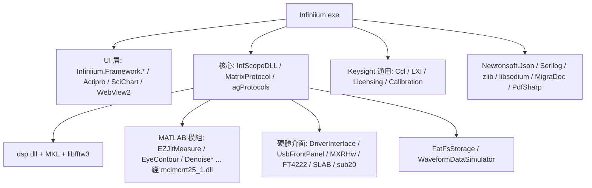

# Infiniium Offline (11.80) 檔案架構圖

來源:`C:\Program Files\Infiniium\`(主程式 `Infiniium.exe`)。原生/.NET DLL 共 66 個,另有 MATLAB Compiler 編譯模組(MATLAB Runtime 25.1,`mclmcrrt25_1.dll`)。

## 目錄結構

```
N8900A/
├─ (架構圖已移至 docs/reference/N8900A-架構圖.md)
├─ 1_Core/                      Infiniium 核心 (19)
│  ├─ InfScopeDLL.dll           示波器核心引擎 (原生 x64 C++, 71MB)
│  ├─ MatrixProtocol.dll        協定/序列匯流排解碼核心
│  ├─ MatrixManagedServices.dll .NET 託管服務層
│  ├─ InfIf / InfUtil / InfThunker / InfOsThunker / DriverInterface
│  ├─ OsDeviceAssistant / FatFsStorage / UsbFrontPanel(+Managed) / FpanelAprobe
│  └─ Infiniium.BsdlReader、Infiniium.Framework.* (UI 框架)
├─ 2_Keysight_Common/           Keysight 通用元件 (9)
│  ├─ dsp.dll                   Keysight DSP 函式庫 (MKL;唯一一份)
│  └─ Ccl.* / Lxi / Licensing / CalibrationAdvisor / ApiClient 等
├─ 3_Hardware_Interface/        硬體/介面 (9)
│  ├─ MXRHw, PCIeAutoprobeInterface, Phoenix
│  ├─ LibFT4222-64 (FTDI)、SLABHID* (Silicon Labs)、sub20
│  └─ WaveformDataSimulator、NoteCtrl
├─ 4_ThirdParty/                第三方函式庫 (27)
│  ├─ SciChart、Actipro、WebView2、MigraDoc/PdfSharp
│  └─ Newtonsoft.Json、Serilog、libfftw3、libsodium、zlib 等
├─ 5_Protocols/
│  └─ agProtocols.dll           序列匯流排協定解碼
├─ 6_MATLAB_Compiled/           MATLAB 編譯模組 (30 DLL + 29 CTF + 8 個 _mcr 展開目錄)
│  ├─ *.dll / *.ctf             DLL 為殼,演算法在加密的 CTF 內
│  ├─ *_mcr/                    CTF 展開目錄(.m 皆為加密格式,不可直接讀)
│  └─ matlab_dll_list.txt       InfScopeDLL 延遲載入的 44 個 MATLAB DLL 清單
├─ 7_參考資料/                  截圖
├─ InfScopeDLL_decompiled/      分析產物:InfScopeDLL.dll 反組譯 (分析文件在 docs/reference/)
└─ dsp_analysis/                分析產物:dsp.dll 反組譯 (分析文件在 docs/reference/)
```

## 層級關係



## 反組譯結論摘要

| 檔案 | 類型 | 結論 |
|---|---|---|
| `InfScopeDLL.dll` | 原生 x64 PE | 含 `cDualDiracCDFModel`(兩次 `erfc` 核心已還原)、`cRjDjMeasOp`、`cJitterSpectrumOp`、`cBerBathtubOp`、`cRealTimeEyeMeasOp`、PLL 一~五階參數介面;抖動分解與眼圖本體在 MATLAB 模組 |
| `dsp.dll` | 原生 x64 PE | 通用 DSP(FFT/FIR/重取樣/內插/直方圖/統計,`dspi_edge` 線性交越);**無**抖動/眼圖/CDR 專用函式;`erf/erfc/gamma` 為未實作 stub |
| MATLAB 模組 | MATLAB Compiler | 演算法主體。`EZJitMeasure`(抖動分解)、`EyeContour`(眼圖輪廓)、`DenoiseJNU/POJ/TJpp`(抖動去雜訊)等 |

詳見 `docs/reference/N8900A-InfScopeDLL分析.md`、`docs/reference/N8900A-dsp分析.md`。

## 6_MATLAB_Compiled 模組分類

已取得 30 個 DLL;`InfScopeDLL` 引用的 44 個中,尚缺 15 個(另有 `FilterTIEPCIE` 為額外取得,InfScopeDLL 未直接引用)。

| 類別 | 已取得 | 
|---|---|
| 抖動/眼圖 | EZJitMeasure、EyeContour、DenoiseJNU、DenoisePOJ、DenoiseTJpp、FilterTIEPCIE、CPhyThreshold |
| 相位/頻譜 | CalcPN、PhDevLin、FindPhase、Find3dBPoint、ComplexBandpass、DspUtils |
| 波形去雜訊/有效位元 | DenoiseWfm、DenoiseWfmCal、DenoiseWfmReadCal、EffBits |
| 校正/濾波/等化 | CalcCorrFilter、CalcCorrFreqResp、CalcTransFunc、CreateFIRFilter、CascadeParamFiles、TrainFFE、PulseFitTapsDFE、PulseFitVector |
| 探棒/纜線/串擾 | PrecProbe、PrecCable、CrosstalkDriver、MPERead、MPEWrite |

**尚缺**(InfScopeDLL 有引用):`PlotRTEye`(即時眼圖繪製)、`SplineInterp`、`PilotPhaseDetect`、`GainPhaseCorrection`、`SynthesizePhaseShiftFilter`、`Calc_SinesRelMagPh`、`Calc_SquaresRelMagPh`、`CW_Source_Set`、`Gen_AcqCorrFiltersGmax`、`Gen_AcqCorrFiltersMyst`、`Gen_DeltaFR_FromCal`、`IF_Auto_Cal`、`LB_CP_Auto_Cal`、`PlotAcqData`、`RecombineFPGA`。

## 整理紀錄(2026-10-22)

- 刪除 `N8900A/dsp.dll`(與 `2_Keysight_Common/dsp.dll` SHA-1 相同);`dsp_analysis/reproduce.sh`、`README.md` 的路徑已改指向後者。
- 刪除 `matlab-dll/`(29 個 DLL 皆與 `MATLAB2025A/` 同雜湊,後者為超集,多了 CTF 與 _mcr)。
- `PhDevLin.dll` 原放 `3_Hardware_Interface/`,實為 MATLAB 模組(`mlfPhDevLin`),移到 `6_MATLAB_Compiled/`,並刪除重複份。
- `MATLAB2025A/` 改名為 `6_MATLAB_Compiled/`;截圖移到 `7_參考資料/`;`matlab_dll_list.txt` 移入 `6_MATLAB_Compiled/`。

註:Phoenix、MXRHw、NoteCtrl 等用途來自檔名推測,未經反組譯確認。
