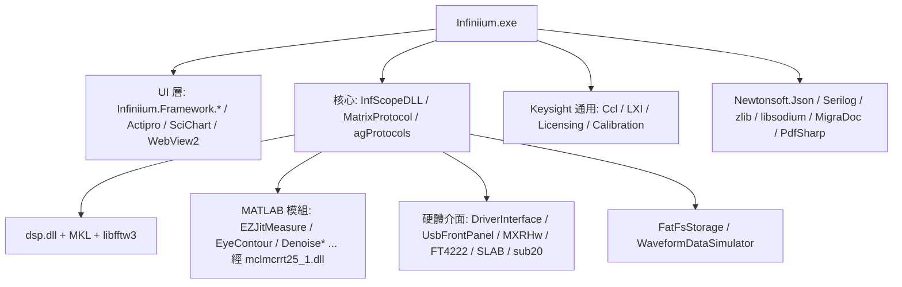

# N8900A 參考

> 由下列檔案合併而成（原檔見 git 歷史）：N8900A-架構圖.md、N8900A-InfScopeDLL分析.md、N8900A-dsp分析.md


---

## 〔N8900A-架構圖〕

## Infiniium Offline (11.80) 檔案架構圖

來源:`C:\Program Files\Infiniium\`(主程式 `Infiniium.exe`)。原生/.NET DLL 共 66 個,另有 MATLAB Compiler 編譯模組(MATLAB Runtime 25.1,`mclmcrrt25_1.dll`)。

### 目錄結構

```
N8900A/
├─ (架構圖已移至 docs/reference/N8900A.md)
├─ 1_Core/                      Infiniium 核心 (19)
│  ├─ InfScopeDLL.dll           示波器核心引擎 (原生 x64 C++, 71MB)
│  ├─ MatrixProtocol.dll        協定/序列匯流排解碼核心
│  ├─ MatrixManagedServices.dll .NET 託管服務層
│  ├─ InfIf / InfUtil / InfThunker / InfOsThunker / DriverInterface
│  ├─ OsDeviceAssistant / FatFsStorage / UsbFrontPanel(+Managed) / FpanelAprobe
│  └─ Infiniium.BsdlReader、Infiniium.Framework.* (UI 框架)
├─ 2_Keysight_Common/           Keysight 通用元件 (9)
│  ├─ dsp.dll                   Keysight DSP 函式庫 (MKL;唯一一份)
│  └─ Ccl.* / Lxi / Licensing / CalibrationAdvisor / ApiClient 等
├─ 3_Hardware_Interface/        硬體/介面 (9)
│  ├─ MXRHw, PCIeAutoprobeInterface, Phoenix
│  ├─ LibFT4222-64 (FTDI)、SLABHID* (Silicon Labs)、sub20
│  └─ WaveformDataSimulator、NoteCtrl
├─ 4_ThirdParty/                第三方函式庫 (27)
│  ├─ SciChart、Actipro、WebView2、MigraDoc/PdfSharp
│  └─ Newtonsoft.Json、Serilog、libfftw3、libsodium、zlib 等
├─ 5_Protocols/
│  └─ agProtocols.dll           序列匯流排協定解碼
├─ 6_MATLAB_Compiled/           MATLAB 編譯模組 (30 DLL + 29 CTF + 8 個 _mcr 展開目錄)
│  ├─ *.dll / *.ctf             DLL 為殼,演算法在加密的 CTF 內
│  ├─ *_mcr/                    CTF 展開目錄(.m 皆為加密格式,不可直接讀)
│  └─ matlab_dll_list.txt       InfScopeDLL 延遲載入的 44 個 MATLAB DLL 清單
├─ 7_參考資料/                  截圖
├─ InfScopeDLL_decompiled/      分析產物:InfScopeDLL.dll 反組譯 (分析文件在 docs/reference/)
└─ dsp_analysis/                分析產物:dsp.dll 反組譯 (分析文件在 docs/reference/)
```

### 層級關係



### 反組譯結論摘要

| 檔案 | 類型 | 結論 |
|---|---|---|
| `InfScopeDLL.dll` | 原生 x64 PE | 含 `cDualDiracCDFModel`(兩次 `erfc` 核心已還原)、`cRjDjMeasOp`、`cJitterSpectrumOp`、`cBerBathtubOp`、`cRealTimeEyeMeasOp`、PLL 一~五階參數介面;抖動分解與眼圖本體在 MATLAB 模組 |
| `dsp.dll` | 原生 x64 PE | 通用 DSP(FFT/FIR/重取樣/內插/直方圖/統計,`dspi_edge` 線性交越);**無**抖動/眼圖/CDR 專用函式;`erf/erfc/gamma` 為未實作 stub |
| MATLAB 模組 | MATLAB Compiler | 演算法主體。`EZJitMeasure`(抖動分解)、`EyeContour`(眼圖輪廓)、`DenoiseJNU/POJ/TJpp`(抖動去雜訊)等 |

詳見 `docs/reference/N8900A.md`、`docs/reference/N8900A.md`。

### 6_MATLAB_Compiled 模組分類

已取得 30 個 DLL;`InfScopeDLL` 引用的 44 個中,尚缺 15 個(另有 `FilterTIEPCIE` 為額外取得,InfScopeDLL 未直接引用)。

| 類別 | 已取得 | 
|---|---|
| 抖動/眼圖 | EZJitMeasure、EyeContour、DenoiseJNU、DenoisePOJ、DenoiseTJpp、FilterTIEPCIE、CPhyThreshold |
| 相位/頻譜 | CalcPN、PhDevLin、FindPhase、Find3dBPoint、ComplexBandpass、DspUtils |
| 波形去雜訊/有效位元 | DenoiseWfm、DenoiseWfmCal、DenoiseWfmReadCal、EffBits |
| 校正/濾波/等化 | CalcCorrFilter、CalcCorrFreqResp、CalcTransFunc、CreateFIRFilter、CascadeParamFiles、TrainFFE、PulseFitTapsDFE、PulseFitVector |
| 探棒/纜線/串擾 | PrecProbe、PrecCable、CrosstalkDriver、MPERead、MPEWrite |

**尚缺**(InfScopeDLL 有引用):`PlotRTEye`(即時眼圖繪製)、`SplineInterp`、`PilotPhaseDetect`、`GainPhaseCorrection`、`SynthesizePhaseShiftFilter`、`Calc_SinesRelMagPh`、`Calc_SquaresRelMagPh`、`CW_Source_Set`、`Gen_AcqCorrFiltersGmax`、`Gen_AcqCorrFiltersMyst`、`Gen_DeltaFR_FromCal`、`IF_Auto_Cal`、`LB_CP_Auto_Cal`、`PlotAcqData`、`RecombineFPGA`。

### 整理紀錄(2026-10-22)

- 刪除 `N8900A/dsp.dll`(與 `2_Keysight_Common/dsp.dll` SHA-1 相同);`dsp_analysis/reproduce.sh`、`README.md` 的路徑已改指向後者。
- 刪除 `matlab-dll/`(29 個 DLL 皆與 `MATLAB2025A/` 同雜湊,後者為超集,多了 CTF 與 _mcr)。
- `PhDevLin.dll` 原放 `3_Hardware_Interface/`,實為 MATLAB 模組(`mlfPhDevLin`),移到 `6_MATLAB_Compiled/`,並刪除重複份。
- `MATLAB2025A/` 改名為 `6_MATLAB_Compiled/`;截圖移到 `7_參考資料/`;`matlab_dll_list.txt` 移入 `6_MATLAB_Compiled/`。

註:Phoenix、MXRHw、NoteCtrl 等用途來自檔名推測,未經反組譯確認。


---

## 〔N8900A-InfScopeDLL分析〕

## InfScopeDLL.dll 原生反組譯與量測功能分析

分析日期：2026-10-22。已先閱讀 `docs/reference/ilspycmd-操作說明.md`。所有分析產物及重現腳本均置於本資料夾；原 DLL 僅以讀取方式開啟，未執行或修改。

### 結論與分析範圍

此檔為 **Windows x86-64 原生 PE32+ DLL**，不是可用 ilspycmd 還原成 C# 的 .NET 組件。已完成可執行區段的線性組合語言反組譯、一般／延遲匯入表、匯出表、ASCII／UTF-16LE 字串、C++ RTTI／虛擬函式表及重點呼叫分析。這些產物不是可重新編譯的完整 C++ 專案。

最具體的發現：

- 抖動：有 `cRjDjMeasOp`、`cRJDJCDFModel`、`cDualDiracCDFModel`、`cJitterSpectrumOp`、`cBerBathtubOp`、`cJitterTailFitBathtubOp` 等類別。已還原 Dual-Dirac 類別內一段使用兩次 `erfc` 的數值核心。
- 眼圖：有 `cRealTimeEyeMeasOp`，以及眼高、眼寬、交越、眼圖抖動、輪廓與週期的量測識別字。已確認呼叫外部 `EyeContour.dll!mlfEyeContour` 與 `PlotRTEye.dll!mlfPlotRTEye` 的位置。
- 時脈：有邊緣搜尋策略、時脈恢復相依處理、PLL 前後時脈資料，以及一／二／三／五階 PLL 和 explicit／equalized 模式的設定／報表字串。這些證據尚不足以還原各階 PLL 的差分方程及係數。
- `A_MeasJitterComponents` 字串所屬區段確實呼叫 `EZJitMeasure.dll!mlfEZJitMeasure`。完整抖動分解與擬合有外部模組邊界，不能把本 DLL 的包裝程式當成全部演算法。

### 檔案辨識與工具

| 項目 | 結果 |
|---|---|
| 來源 | `N8900A/1_Core/InfScopeDLL.dll` |
| 大小 | 74,521,216 bytes，約 71.07 MiB |
| SHA-256 | `1dc2357b092030a1967ddb12c99f53ae8d4808af7cd340f56d53a2c8a750a949` |
| `file` | `PE32+ executable (DLL) (GUI) x86-64, for MS Windows` |
| PE Machine | `0x8664`，AMD64 |
| CLR Runtime Header | RVA 與大小皆為 `0`，沒有 CLR 組件入口 |
| 偏好載入基址 | `0x180000000` |
| 匯出 | 333 筆 |
| 匯入 | 1,797 筆，含一般及延遲匯入 |
| `.pdata` | 176,208 筆 runtime-function 記錄；不等於原始碼函式數量 |
| RTTI | 掃描出 5,217 筆類別 TypeDescriptor 名稱候選 |

`file` 的原生 PE 判斷、MSVC C++ RTTI、MFC／VC Runtime 匯入及空的 CLR directory 相互一致。雖然環境已有 `ilspycmd` 與 `dotnet`，依操作說明的適用範圍，本次不使用 ilspycmd。

使用 `/usr/bin/objdump`（Apple LLVM 21.0.0）、`/usr/bin/strings`、Python 3 標準函式庫。PATH 未找到 `r2`／`radare2`／`rabin2`／Ghidra，`/Applications` 也未見 Ghidra、IDA、Hopper；未安裝額外套件。Python 環境亦沒有 pefile、capstone、lief，因此以本資料夾中的腳本解析 PE。

CodeView RSDS 記錄指向 `C:\kd\Inf\1180\source\Gui\Gui\bin\Release\InfScopeDll.pdb`，age 為 1；這只是二進位內的建置路徑，本次沒有載入該 PDB，不能由此宣稱已有私有函式符號。詳細欄位見 [pe-summary.json](../../N8900A/InfScopeDLL_decompiled/pe-summary.json)。

### 位址與證據讀法

本文件表格均以 **RVA** 為主；偏好 VA = `0x180000000 + RVA`。實際載入後須使用程序的實際基址處理 ASLR。檔案 offset 與 RVA 不同，請用 `strings-focus.tsv` 的對照欄位，不能把 `strings -t x` 的 offset 直接交給反組譯器當 VA。

證據分為：匯出符號（名稱確定）、RTTI／vftable（類別與槽位可定位，但方法名稱未知）、字串引用（證明該區段使用字串，功能名仍屬推定）、指令／匯入呼叫（可確認運算或模組邊界）。`focus-functions.asm` 中的 `sub_...` 是分析標籤，非原始名稱。

LLVM 會將未具名位址顯示成最近的匯出符號加 offset，例如 `<CallMethod+...>`；**這不表示整段程式真的屬於 CallMethod**。請以 RVA、`.pdata` 範圍及旁註證據定位。`.pdata` 記錄也可能是例外處理 funclet，不能直接當成完整原始函式。

### 抖動與 BER／bathtub

#### 類別與重要區段

| 類別／識別字 | 相關 RVA | 可確認內容 |
|---|---|---|
| `cRjDjMeasOp` | vftable `0x378B688`；slot 3 → `0x19AA3A0` | RTTI 確認類別；槽位名稱未知，該槽不能直接命名為 RJ/DJ 數值計算 |
| `cRJDJCDFModel` | vftable `0x376FBD8` | CDF 模型類別；slot 1 指向 `0x2B68897`，未據此推定具體數值模型 |
| `cDualDiracCDFModel` | vftable `0x376FBF0`；slot 1 → `0x18E8EC0` | 152 bytes 的 `erfc` 數值核心，見下一節 |
| `cJitterSpectrumOp` | vftable `0x378B9D8` | RTTI 確認頻譜操作類別；未還原整段 FFT 處理流程 |
| `cBerBathtubOp` | vftable `0x378BAF8` | RTTI 確認 BER bathtub 操作類別 |
| `cJitterTailFitBathtubOp` | 見 `rtti-focus-vtables.tsv` | 尾端擬合 bathtub 操作類別 |
| `A_MeasJitterComponents` | `0x115C6A0..0x11613F4` | 多處字串引用；在 `0x115F6CD` 呼叫外部 EZJitMeasure |
| `A_MeasJitterComponentsClockData` | `0x11541D0..0x11543A6` | 時脈資料處理相關區段的字串證據 |
| `RJDJMeasResult` | `0x116D640..0x116DE76` | 結果資料處理相關區段 |
| `GetBathtubDataPlot` | `0x18E9A30..0x18EA0CD` | 資料曲線字串引用 |
| `GetBathtubModelPlot` | `0x18EA940..0x18EAD91` | 模型曲線字串引用 |
| `GetJitterTailfitBathtubDataPlot` | `0x18EBB90..0x18EC021` | 尾端擬合資料曲線字串引用 |
| `GetJitterTailfitBathtubModelPlot` | `0x18EC030..0x18EC4CC` | 尾端擬合模型曲線字串引用 |
| `cNoiseBerBathtubOp::GetNoiseBathtubModelPlot` | `0x19B0750..0x19B0D0C` | 含完整類別／方法名的診斷字串；仍非匯出符號 |

位址範圍的右端皆不包含在內。完整槽位與其目標見 [rtti-focus-vtables.tsv](../../N8900A/InfScopeDLL_decompiled/rtti-focus-vtables.tsv)；完整候選區段與理由見 [focus-functions.tsv](../../N8900A/InfScopeDLL_decompiled/focus-functions.tsv)。

設定字串包含 `algTailfitOnly`、`algSpectralTailfit`、`repTailfit`、`Pam4JitterJnu`、`Pam4JitterDualDirac`、`Pam4JitterPcie6dd`、`IEEE JnU Jitter Extrapolation`、`PCIe6 12E Jitter Extrapolation`。可確認存在這些模式／選項名稱，不能僅憑選項推定其數學實作。報表字串另含 BUJ、PJ、DJ、UDJ 的 Dual-Dirac 結果欄位。

#### 已還原的 Dual-Dirac 數值核心

依 RTTI，`0x18E8EC0` 是 `cDualDiracCDFModel` 的 slot 1。指令在 `0x18E8F06` 與 `0x18E8F33` 經 IAT `0x32AD330` 呼叫 CRT `erfc`；不是僅以名稱猜測。常數已直接讀取二進位：

| 常數 RVA | 原始 bytes，little endian | 意義 |
|---|---|---|
| `0x3372670` | `0000000000000080` | 負零 bit pattern，供 XOR 翻轉 double 符號 |
| `0x33724B8` | `000000000000d03f` | `0.25` |
| `0x376FCB0` | `cd3b7f669ea0d63f` | `0.3535533905932738`，即 `1/(2√2)` |

以分析用參數名表示，其指令等價運算為：

```text
k = 0.3535533905932738
result = (double_at_this_plus_8 * 0.25) * (
    erfc(((-x - x) - a) * k / s_left)
  + erfc((b - (x + x)) * k / s_right)
)
```

Win64 呼叫慣例對照：RCX=this、XMM1=x、XMM2=s_left、XMM3=a；進入函式時的 `[RSP+0x28]` 為 s_right、`[RSP+0x30]` 為 b。`this+8` 欄位、a／b 的物理意義及單位尚未確認，s_left／s_right 名稱亦為分析命名。這段運算與雙尾 Gaussian／Dual-Dirac 模型相容，但不代表已還原 RJ、DJ 的估計器、擬合方式、BER 正規化或完整抖動分離流程。

原始指令見 [dual-dirac-kernel.asm](../../N8900A/InfScopeDLL_decompiled/dual-dirac-kernel.asm)，手動整理的等價 C++ 偽碼見 [dual_dirac_reconstructed.cpp](../../N8900A/InfScopeDLL_decompiled/dual_dirac_reconstructed.cpp)。偽碼不是自動反編譯成果，也未假定原本不存在的錯誤處理。

### 眼圖量測

`cRealTimeEyeMeasOp` 的 RTTI 對應 vftable RVA `0x378B448`；slot 2 指向 `0x19A73C0`。該槽只足以作為類別定位入口，不能直接當成眼圖統計演算法。

| 量測／處理識別字 | 證據 |
|---|---|
| `measEyeHeight` | 字串 RVA `0x33680D8`，引用區段 `0x29EC30..0x29EE0C` |
| `measEyeWidth` | 字串 RVA `0x3368358`，引用區段 `0x29F6F0..0x29F8D2` |
| `measEyeJitter`、`measEyeJit` | 字串 RVA `0x3368430`、`0x3368690` |
| `measEyeCross`、`measEyeEdge` | 字串 RVA `0x3368758`、`0x3368820` |
| `measEyeOneLevel`、`measEyeZeroLevel` | 字串 RVA `0x3368160`、`0x33681E0` |
| `measEyeTopBase`、`measEyeContour`、`measEyePeriod` | 字串 RVA `0x33688F0`、`0x3368930`、`0x3368F00` |
| `A_AnalyzeEyeContour` | 字串引用區段 `0x10EAAC0..0x10EB0EB` |
| `EyeContour.dll!mlfEyeContour` | 呼叫指令 RVA `0x1140C6D`，經 thunk `0x252654C` |
| `PlotRTEye.dll!mlfPlotRTEye` | 呼叫指令 RVA `0x1629CF8`，經 thunk `0x2527B92` |

前述 `meas...` 是註冊／分類識別字，**不是已恢復的 C++ 方法名**；低位址的引用區段多為初始化／註冊程式，不能當作眼高或眼寬計算本體。眼圖直方圖、閾值、插值、眼高／眼寬的精確公式尚未完成還原。`cMystFpgaSerdesCharacterizeEye` 等 SerDes 硬體掃描類別也存在，需與示波器的即時眼圖量測分開解讀。

### 時脈、邊緣與 PLL

| 類別／區段 | 相關 RVA | 判讀 |
|---|---|---|
| `cFindAllEdgesSwStrategy` | vftable `0x33742C0`，slot 1 → `0x10CC190` | 軟體邊緣搜尋策略，方法名未知 |
| `cFindAllEdgesPAMStrategy` | vftable `0x33742D8`，slot 1 → `0x10CD8E0`、slot 2 → `0x10CE010` | PAM 邊緣搜尋策略，方法名未知 |
| `cFindAllEdgesHwStrategy`、`cFindAllEdgesDFEStrategy`、`cFindAllEdgesCPHYStrategy` | 見 RTTI 表 | 硬體、DFE、C-PHY 的策略類別 |
| `A_MeasClockRecoveryDepend` | `0x10F4010..0x10F41E7` | 時脈恢復相依處理的字串引用 |
| `A_MeasClockRecoveryDependMultiSrc` | `0x10F4BD9..0x10F4DBF` | 多來源相依處理；可能是 funclet，不能只憑邊界認定完整函式 |
| `A_DoMeasClockRecoveryDependMultiSrc` | `0x10FB340..0x10FB585` | 同時有 DDR5／MIPI C-PHY 診斷字串 |
| `PrePLLClocks`／`PostPLLClocks` | `0x10FF4E0..0x1100659` | 同區段使用 PLL 前後資料名稱，可作為追蹤入口 |
| `*ClockRecoveryGenInterop` 名稱集合 | `0x12A7020..0x12A79B6` | 字串分派／註冊入口；不是各種 PLL 演算法本體 |
| `measPhaseJitter` | 引用區段 `0x2D0550..0x2D0709` | 相位抖動量測識別字的註冊線索 |
| `measPeriod` | 字串 RVA `0x336EBD8` | 週期量測識別字 |

`*ClockRecoveryGenInterop` 包含 Equalized、Explicit、ExplicitNoEq、FirstOrder、SecondOrder、ThirdOrder、FifthOrder、StandalonePll、FixedButNotAutomatic、FlexRay、MipiCphy、DDR5 等名稱。

設定／報表字串顯示一／二階有 Loop Bandwidth、二／三階有 Damping Factor、三階有 Omega Natural／Omega Pole、五階有 Omega 0／Omega 1／Omega LF，並有 PLL Settling。Explicit 模式另含 Clock Source、Clock Multiplier、Edges。上述是可讀到的參數介面證據；未從本次指令分析取得迴路濾波器係數、鎖定判定或各階離散化細節。另有 `Use Hw Clock Recovery`、`PllIdleClocks`、`PLL Phase Align` 的設定字串。

### 對外函式入口

以下名稱直接來自 PE 匯出表，可作為程式進入點；多數是 UI／控制包裝，不能視作數值核心。

| 匯出名稱 | ordinal | RVA |
|---|---:|---|
| `WuCopyClockRecoverySettings` | 31 | `0x198B4F0` |
| `WuExplicitClockRecovery` | 55 | `0x198B4D0` |
| `WuGetClockRecWizardInfo` | 71 | `0x1F14D40` |
| `WuGetEyeScanResults` | 81 | `0x126EC40` |
| `WuGetRjDjWizardString` | 153 | `0x1F14D60` |
| `WuSaveJitterData` | 268 | `0x1A4DE80` |

例如 `WuCopyClockRecoverySettings` 在 RVA `0x198B4F0` 以 `jmp` 跳到 `0x1663D70`。`WuReadClock` 也有匯出，但僅憑名稱不能認定它是波形時脈量測，故未納入核心清單。

### 外部演算法邊界

已從指令追到以下實際呼叫，而非僅看 DLL 檔名：

| 外部函式 | 呼叫點 RVA | 包含它的 `.pdata` 區段起點 |
|---|---|---|
| `EZJitMeasure.dll!mlfEZJitMeasure` | `0x115F6CD`、`0x1163C86` | `0x115C6A0`、`0x11616D0` |
| `EyeContour.dll!mlfEyeContour` | `0x1140C6D` | `0x1140A8E` |
| `PlotRTEye.dll!mlfPlotRTEye` | `0x1629CF8` | `0x1629BFA` |
| `DenoiseTJpp.dll!mlfDenoiseTJpp` | `0x19C0E54` | `0x19C09E0` |
| `DenoiseJNU.dll!mlfDenoiseJNU` | `0x19C19AC` | `0x19C1330` |
| `DenoisePOJ.dll!mlfDenoisePOJ` | `0x19C2AFC` | `0x19C2568` |

另外有 `mclmcrrt25_1.dll` 的 mxArray／mcl runtime 匯入，以及 `libfftw3-3.dll` 的 `fftw_plan_dft_1d`、`fftw_plan_dft_r2c_1d`、`fftw_plan_dft_c2r_1d`、`fftw_execute`。前者與 MATLAB Compiler 模組介面一致；後者證明本 DLL 使用 FFTW，但尚未逐條建立其與 jitter spectrum 的資料流關係。`dsp.dll` 另提供重取樣及複數／縮放運算。

完整外部呼叫證據見 [dependency-callers.tsv](../../N8900A/InfScopeDLL_decompiled/dependency-callers.tsv)、[dependency-callers.asm](../../N8900A/InfScopeDLL_decompiled/dependency-callers.asm)。本次未分析上述外部 DLL 的內容，因此未聲稱已恢復其中的數值實作。

### 輸出索引

| 產物 | 內容 |
|---|---|
| `native-full.asm.gz` | `.text`、`.textidx` 等可執行區段的完整線性 LLVM Intel 語法輸出；12,689,868 行，以 gzip 壓縮 |
| `focus-functions.asm`／`.tsv` | 重點區段的易讀指令與定位依據；範圍數見 `extraction-run.log` |
| `focus-direct-calls.tsv` | 重點區段內可直接解析的 call／jmp 目標；不含所有間接呼叫 |
| `dual-dirac-kernel.asm`／`dual_dirac_reconstructed.cpp` | 核心指令與手動整理的運算等價偽碼 |
| `exports.tsv`／`imports.tsv` | PE 匯出、一般及延遲匯入，附 RVA／VA |
| `rtti-types-all.tsv`／`rtti-focus-vtables.tsv` | 全部 RTTI 類別名稱候選與重點虛擬表槽位對應 |
| `strings-ascii.txt` | 系統 strings 的完整 ASCII 輸出，附十六進位檔案 offset |
| `strings-utf16le.tsv` | 標準函式庫抽取的 ASCII 可列印字元範圍 UTF-16LE 字串；非完整 Unicode 字串掃描 |
| `strings-focus-initial.txt`／`strings-focus.tsv` | 初步關鍵詞命中及較廣的分類字串，後者附 offset／RVA／VA |
| `string-xrefs.tsv` | 1,880 筆直接 RIP-relative 參照；僅匹配字串起點，含初始化程式搬移文字的指令 |
| `algorithm-import-xrefs.tsv` | CRT 數學、FFTW 與特定外部模組的 IAT 參照，含 thunk／位址取得，不全是呼叫 |
| `dependency-callers.tsv`／`.asm` | 追到特定延遲匯入 thunk 的直接呼叫與其所在區段 |
| `runtime-functions.tsv` | 全部 `.pdata` begin／end／unwind 記錄 |
| `pe-headers.txt`／`pe-summary.json` | LLVM PE 標頭、結構與 SHA-256 摘要 |
| `analysis-index.json` | 腳本間使用的機器可讀位址索引 |
| `*-run.log`、`*-summary.json`、`*.stderr.txt` | 執行結果、統計與工具診斷；空 stderr 表示該工具未寫入診斷 |
| `analyze_pe.py`、`disassemble.py`、`extract_focus.py`、`trace_dependency_calls.py`、`verify_outputs.py` | 可重現分析與校驗腳本，僅使用 Python 標準庫及 objdump |
| `verification.json`／`SHA256SUMS.txt` | 最終唯讀來源校驗、gzip／表格檢查與輸出雜湊清單 |

### 重現方式

在專案根目錄執行；所有重導向都留在本資料夾。以下會重新產生分析產物：

```sh
file N8900A/1_Core/InfScopeDLL.dll
strings -a -t x N8900A/1_Core/InfScopeDLL.dll > N8900A/InfScopeDLL_decompiled/strings-ascii.txt
objdump --file-headers --section-headers --private-headers N8900A/1_Core/InfScopeDLL.dll > N8900A/InfScopeDLL_decompiled/pe-headers.txt
python3 N8900A/InfScopeDLL_decompiled/analyze_pe.py
python3 N8900A/InfScopeDLL_decompiled/disassemble.py
python3 N8900A/InfScopeDLL_decompiled/extract_focus.py
python3 N8900A/InfScopeDLL_decompiled/trace_dependency_calls.py
python3 N8900A/InfScopeDLL_decompiled/verify_outputs.py
```

查看完整指令可用 `gzip -dc N8900A/InfScopeDLL_decompiled/native-full.asm.gz | less`。針對已知函式查詢時，objdump 的 start／stop 必須使用 **VA**，例如：

```sh
objdump -d --x86-asm-syntax=intel \
  --start-address=0x1818e8ec0 --stop-address=0x1818e8f58 \
  N8900A/1_Core/InfScopeDLL.dll
```

### 限制與後續追查入口

最終校驗通過：原 DLL 的 SHA-256 與初始分析一致，gzip 完整可讀，表格筆數與重點區段一致。共擷取 131 個重點區段、13 個特定外部模組直接呼叫點。完整線性輸出中仍有 **5,705 行 `<unknown>`**，表示 LLVM 未成功解碼，或掃到了非指令資料；不能宣稱所有指令均已正確解碼。校驗只檢查產物完整性與證據一致性，未在 Windows 上執行量測或驗證儀器的數值結果。

線性反組譯不會自動恢復控制流程、型別或原始方法名，可執行節內夾雜的資料也可能被誤解碼。字串參照只追到 objdump 顯示的直接 RIP-relative 目標，未全面處理間接指標、字串中段、虛擬呼叫及執行期分派；RTTI／vftable 由格式特徵辨識，連續函式指標的槽位清單屬候選，可能截斷或跨越相鄰資料，不能視作完整類別宣告。無 `.pdata` 目標只擷取 32／128-byte 視窗，不宣稱是完整函式。

若要繼續還原數值實作，優先在 Ghidra／IDA 載入本 DLL，以 `0x18E8EC0` 為 Dual-Dirac 核心入口，從 `0x115F6CD`／`0x1163C86` 的呼叫準備過程追抖動資料結構，並分別載入 `EZJitMeasure.dll`、`EyeContour.dll`。PLL 可從 `0x10FF4E0` 的前後時脈資料及 `0x12A7020` 的模式分派往下追；目前未取得各階 PLL 的完整係數或眼圖統計公式。


---

## 〔N8900A-dsp分析〕

## N8900A/2_Keysight_Common/dsp.dll 靜態分析

分析日期：2026-10-22。範圍為 `N8900A/2_Keysight_Common/dsp.dll`，另唯讀比對同目錄樹下的副本與 `scope_tool/analysis/` 程式。所有產物均在本資料夾，未修改原始 DLL、Python 程式，也未讀寫 `N8900A/InfScopeDLL_decompiled/`。

### 結論

這是 **Windows x64 原生 PE32+ DLL，不是 .NET 組件**。它提供 398 個具名匯出，全部屬 `dsp*` API；沒有 ordinal-only 或 PE forwarder。DLL 的資源明示 `Keysight DSP Library DLL (MKL)`，且有真實的 MKL DFTI 延遲匯入與 FFT 呼叫鏈，不只是無法確認的 MKL 字串。

目前證據將它定位為 **通用 DSP／統計底層**：有 FFT、FIR、重取樣、內插、閾值交越、直方圖與迴歸；**未找到可辨識的 TIE、RJ/DJ/PJ 分離、Dual-Dirac、眼圖量測、clock recovery 或 PLL 專用匯出／字串**。這只代表在此檔的匯出與可讀字串中未找到，不構成「Keysight 全產品沒有這些演算法」的結論，也不能排除未具名內部程式碼。

最有助於現有 Python 專案的是 `dspi_edge` 的線性交越公式、FFT 的 wrapper／MKL 分層、統計量的定義，以及重取樣延遲與狀態的設計。沒有足夠證據把目前的固定頻率時脈還原或眼寬 `UI−6σ` 認定為 Keysight 的實作。

### 檔案身分與格式

| 項目 | 結果 |
|---|---|
| 大小 | 476,456 bytes |
| SHA-256 | `90c98180fa0d5fbc99a9a8bae0651551ff9334b2567f18ab7928c6420c183601` |
| `file` | `PE32+ executable (DLL) (GUI) x86-64, for MS Windows` |
| Machine／Magic | `0x8664`／`0x020b` |
| ImageBase／進入點 RVA | `0x61000000`／`0x572d0` |
| CLR Runtime Header | RVA = 0、Size = 0；沒有 CLR metadata 入口 |
| Debug Directory | RVA = 0、Size = 0；沒有由此取得 PDB 路徑 |
| 連結器版本 | 12.0；搭配 `MSVCR120.dll`，與 VC++ 2013 世代相符（工具鏈判斷屬推論） |
| PE timestamp 原始值 | 1425099512；只是標頭紀錄，非獨立證實的建置時間 |
| CompanyName | `Keysight Technologies` |
| FileDescription | `Keysight DSP Library DLL (MKL)` |
| FileVersion／ProductVersion | `3.29.0.0`／`3.28.0.0`，資源本來就不同 |
| `dsp_version()` | 指令直接回傳 `0x149` = 329；`dspf_version` 同 RVA |
| 另一份副本 | `N8900A/2_Keysight_Common/dsp.dll` 大小、雜湊與內容完全相同 |

格式證據見 [file.txt](../../N8900A/dsp_analysis/file.txt)、[objdump 標頭](../../N8900A/dsp_analysis/objdump_private_headers.txt)、[PE 結構摘要](../../N8900A/dsp_analysis/pe_summary.json)、[UTF-16LE 資源字串](../../N8900A/dsp_analysis/strings_utf16le.tsv)。有 `mscoree.dll` 字串與否不是本次主要判準；CLR data directory 為零及實際 x86-64 機器碼共同支持原生 DLL 判定。

### 方法與可重現性

本機可用 `/usr/bin/file`、`/usr/bin/strings`、`/usr/bin/objdump`（Apple LLVM 21.0.0，支援 COFF x86-64）及 `/opt/homebrew/bin/python3`。`r2/radare2`、Ghidra 的 `analyzeHeadless/ghidraRun` 未在 PATH 或所檢查的 `/Applications`、Homebrew、使用者工具位置找到；Python 也沒有 `pefile/capstone/lief`。因此採用 objdump 原生反組譯，加上本資料夾內的無第三方相依 PE 解析器。未安裝額外工具。

在專案根目錄執行：

```sh
sh N8900A/dsp_analysis/reproduce.sh
```

主要命令：

```sh
file N8900A/2_Keysight_Common/dsp.dll
strings -a -t x N8900A/2_Keysight_Common/dsp.dll
objdump -p N8900A/2_Keysight_Common/dsp.dll
objdump -h N8900A/2_Keysight_Common/dsp.dll
objdump -d --x86-asm-syntax=intel N8900A/2_Keysight_Common/dsp.dll
python3 N8900A/dsp_analysis/analyze.py
```

重現腳本已將輸出重新導向此資料夾。`analyze.py` 唯讀解析 PE sections、export address/name/ordinal tables、一般 import 與 delay import、x64 exception/unwind 表，補取 ASCII 與 UTF-16LE 可讀字串，並產生分類 TSV。`strings_ascii.txt` 的位址是**檔案 offset**；匯出表與筆記另有 RVA／VA，三者不可混用。

已完成全 `.text` objdump 線性掃描反組譯，並對重要入口提供分檔及人工解讀。全段有 43 處 `<unknown>`（[位置清單](../../N8900A/dsp_analysis/unknown_decodes.txt)）；部分與內嵌跳躍表一致，未逐一證實全部原因，因此不能把每行視為可執行指令。重點分檔未含這類標記。分檔採下一個不同的 export RVA 作區間上界，可能包含私有 helper／padding；`.pdata` 常把單一函式分成數段，不能只拿第一段作完整函式。objdump 對未命名程式碼標上的「最近匯出名稱 + offset」也不是可靠的函式歸屬。

### 匯出與第三方歸屬

完整 **398 筆**清單見本頁附錄與 [exports.tsv](../../N8900A/dsp_analysis/exports.tsv)；欄位包含 ordinal、RVA、VA、file offset、name、forwarder。[exports_relevant.tsv](../../N8900A/dsp_analysis/exports_relevant.tsv) 是依關鍵字篩選的相關子集，不代表已逐一確認所有語義。

| 類別 | 可確認歸屬／界線 |
|---|---|
| 所有 `dsp*` 匯出 | Keysight DLL 公開 API；由版本資源與 export table 支持。稱「Keysight API」不等於證明每段演算法均由 Keysight 原創 |
| `dspi_fft` 等 | Keysight 介面／檢查／資料管理，某路徑呼叫外部 MKL，另有本地路徑 |
| `Dfti*` | `small_MKL_dll.dll` 延遲匯入的 MKL DFTI API；**不是 dsp.dll 的匯出** |
| `dsp*_omp_*`、`dsp*_kmp_*` | Keysight wrapper 名稱；底層有 `libiomp5md.dll` ordinal 延遲匯入 |
| `MSVCR120.dll` | Microsoft C runtime／數學／記憶體／檔案 API，包含 `clock` |
| `KERNEL32.dll` | Windows 載入器、環境變數、同步與程序 API |

未取得 `small_MKL_dll.dll`／`libiomp5md.dll` 本體，因此不能判定 MKL 確切版本、CPU kernel 或 OpenMP ordinal 對應的完整名稱。沒有證據顯示這個檔把完整 MKL 引擎靜態包入；已確認的是外部 backend 相依與實際呼叫。

`dspf*` 系列對應大量 float 指令與 4-byte stride，`dsp*` 對應 double 指令與 8-byte stride。`i_` 常見就地運算、`s_` 常見統計、`h_` 常見含狀態處理，這些是觀察到的命名規律，未取得原始 API header。

#### 目標領域的搜尋結果

| 領域 | 相關匯出與字串 | 判讀 |
|---|---|---|
| jitter／TIE／RJ/DJ/PJ／Dual-Dirac | `jitter`、獨立詞 `TIE/RJ/DJ/PJ`、`dirac` 等無命中 | 沒有可辨識的高階分離入口；統計／頻譜工具僅能作元件 |
| 眼圖／bathtub／BER | `eye`、`bathtub`、`BER` 無命中 | `hist` 是一般直方圖，未證實眼圖資料庫、眼高、眼寬或 BER 外插 |
| clock recovery／PLL／CDR | 唯一 `clock` 字串來自 `MSVCR120.dll!clock`，檔案 offset `0x65724` | runtime 計時，不是訊號時脈恢復；`recover/PLL/CDR/phase-lock` 無對應入口 |
| FFT／DFT | `dspi/dspfi_{fft,rfft,irfft,dft,rdft,irdft,dct}`、`dsph/dspfh_{fft,dft}`；`Dfti*` | 多種轉換介面；確認 FFT 的 MKL 呼叫鏈，不能只由名稱保證各格式／尺度 |
| 相位／頻譜輔助 | `dspi/dspfi_{analytic,hilbert,phase,unwrap,unwrap_wnd,mag,magsq}` | 可作相位與頻譜前處理；未見 PLL 控制迴路 |
| 濾波／降採樣 | `dspd/dspfd_{fir,hwfilt,sfir,sfir_deci,deci}`、`dspc/dspfc_{fir,fir2}`、`dspi/dspfi_hwfilt` | 本地 wrapper／數值路徑；`hwfilt` 的具體響應尚未完整還原 |
| 重取樣／重建 | `dspd/dspfd_{rsmp,rsmp2}`、`dspc/dspfc_{rsmp,rsmp_cos,rsmp_pcos}`、`dspi/dspfi_{recon,orecon}`、`dsph/dspfh_rsmp*` | 具有係數、歷史狀態、offset、delay、settle API；不能視同 clock recovery |
| 內插 | `dsp/dspf_{interp,cspline}`、`dspb/dspfb_cspline_2d`、`dspb/dspfb_inter`、`dspi/dspfi_zinter`、`dspu/dspfu_zinter` | `interp/cspline` 已看到實際 spline 與線性路徑；`inter/zinter` 只列名稱線索，未證實是交越或時間內插 |
| 閾值／交越 | `dspi_edge`、`dspfi_edge`；`cross/threshold` 無可讀名稱命中 | edge 已由機器碼確認為單閾值、方向旗標、線性交越時間 |
| 統計／擬合 | `dsps/dspfs_{hist,mean,median,rms,pop_stddev,pop_var,samp_stddev,samp_var,lin_regres,lin_regres2,peak,skew,excess}` | 可作分布、迴歸、尺度比較；不能推出 Dual-Dirac 模型 |
| 視窗 | `dspi/dspfi_window*`、`dsp/dspf_window*_scale/enbw/metric` | 頻譜估測的視窗與 ENBW 候選；沒有證實 jitter 分離流程採用哪一種 |

表中的 `A/B_{x,y}` 表示各前綴與後綴的實際函式家族，確切拼字、ordinal 和 RVA 以附錄為準。關鍵字搜尋有別名與無名稱實作的限制；尤其簡短縮寫採獨立詞匹配，以免把機器碼中偶然可列印的文字誤認作 RJ/PJ。

#### MKL／OpenMP 匯入

一般 import：`KERNEL32.dll`、`MSVCR120.dll`。delay import 如下；完整 IAT 位置見 [imports.tsv](../../N8900A/dsp_analysis/imports.tsv)。

| 相依 DLL | API／ordinal |
|---|---|
| `small_MKL_dll.dll` | `DftiCreateDescriptor`、`DftiCommitDescriptor`、`DftiComputeForward`、`DftiComputeBackward`、`DftiSetValue`、`DftiFreeDescriptor` |
| `libiomp5md.dll` | ordinal 224、705、703、724、727（名稱未解析） |

另有 `MKL_DISABLE_FAST_MM`、`KMP_BLOCKTIME`、`KMP_BLOCKTIME=%d` 字串，以及 `LoadLibraryA` 實際載入兩個 backend 的指令。版本資源、imports 與呼叫鏈三者共同支持 MKL 歸屬。

### 反組譯的重要發現

詳細地址、指令與偽碼見 [reverse_notes.md](../../N8900A/dsp_analysis/reverse_notes.md)，原始全區間見 [disassembly_full.asm](../../N8900A/dsp_analysis/disassembly_full.asm)，重點分檔見 [disassembly/](disassembly/)。

1. **`dspi_edge` RVA `0x2df60`、`dspfi_edge` RVA `0x2e1d0`**：方向 mask 的 bit 0 偵測上升、bit 1 偵測下降；正常有限輸入採 `prev≤thr<next`／`next<thr≤prev`。輸出為 `(i+(thr−a)/(b−a))*scale`，就地壓縮資料並更新長度、尺度設 1。沒有 Python 現有三閾值遲滯與毛刺排除。
2. **`dspi_fft` RVA `0x2ea40`**：可用 backend 時進入 `0x13ce0`，確認呼叫 `DftiComputeForward/Backward`；descriptor 有快取。這個 FFT 路徑仍檢查二次冪長度；未成功載入 backend 時存在本地分支。沒有執行 DLL，無法確認實際環境選到哪條路。
3. **`dsp_interp` RVA `0x35470`、`dsp_cspline` RVA `0xcf10`**：旗標 5 會使用 spline 係數／前置計算；核心亦有線性內插。其餘旗標、外插與所有參數尚未完整恢復。
4. **`dspd_fir` RVA `0xfa20`**：有實／複數的資料與係數分派、本地處理及工作區管理。`dsph_rsmp*` 有額外的延遲／穩定期／歷史狀態接口，對波形處理時序有參考價值。
5. **`dsps_rms` RVA `0x52c20`** 是 `sqrt(magsq_sum/N)`；`dsps_pop_stddev` RVA `0x53b60` 是對 population variance 開根號。兩者不是無條件等價。
6. **八個特殊函式為未實作 stub**：`dspi/dspfi_{erf,erfc,gamma,lgamma}` 全指向 `0x33830`，只有回傳 `-1`。不能拿它們作為 DLL 已具備常態分布尾端／Dual-Dirac 擬合的證據。

### 對 scope_tool/analysis/ 的參考價值

以下為與實際 Python 原始碼的比對及可採用的設計方向，**本任務未變更程式**。這些建議不等於與 Keysight 數值相容的宣稱。

| 現有位置 | DLL 證據 | 可參考之處與界線 |
|---|---|---|
| [clock.py](../../scope_tool/analysis/clock.py) `recover`（第 73 行）、`_grid`（53）、`_seed`（59） | `dspi_edge`、`dsps_lin_regres*` | 可對照交越時間與線性擬合元件；DLL 沒有已辨識的 UI 格號配置、缺邊策略或 PLL，因此目前最小平方／固定頻率模型仍是專案自己的實作選擇 |
| [edge.py](../../scope_tool/analysis/edge.py) `_cross`（26）、`edges`（35） | `dspi_edge` 的分數樣點公式 | 最直接可比對。Python 用實際 t 差與 t 起點、三閾值流程；DLL 用尺度乘索引且不加起點、單閾值。相等閾值時的端點規則也不同；比較時須先統一規則與時間基準 |
| [jitter.py](../../scope_tool/analysis/jitter.py) `measure`（52）、`n_periods`（27）、`period_period`（33）、`width_diffs`（40） | edge、RMS、variance、FFT/hist | 可核對交越→TIE→統計的基礎量。此 DLL 無法證實目前 N 週期、Period-Period 或缺邊不跨的產品定義；也沒有可移植的 RJ/DJ/PJ 分離公式 |
| [eye.py](../../scope_tool/analysis/eye.py) `crossing`（40）、`measure`（76） | `dsps_hist`、`pop_stddev`、`rms`；erf 等是 stub | Python 的 ±3σ 迭代裁切、眼 jitter p-p=6σ、眼寬=UI−6σ 沒有在 DLL 找到對應。多峰、PJ 或離群尾巴不能靠此靜態結果確認其相容性 |
| `eye.py` `rails`（30）、`v_cross`（54）、`density`（94） | spline/線性內插、一般 histogram | 可研究更精細內插與 bin 端點；DLL 沒有已辨識的二維眼圖色階資料庫、UI 40–60% rail 選樣或 crossing 電壓定義。現有顯示補點與原始樣本量測的差異應繼續明確記錄 |
| 未來的 TIE 頻譜／PJ 研究 | FFT、window、ENBW、phase/unwrap、resampling state/delay | 可設計「TIE 格點與缺邊處理→去趨勢→window→FFT→頻譜」實驗；這是延伸方向，並非還原出的 Keysight 分離流程。邊緣事件不等間距時，不能直接把事件序列當均勻時間波形作 Hz 頻譜 |

建議後續數值比對優先順序：先確認交越端點與時間尺度，再確認 RMS／σ 的中心化與分母，再驗證內插／濾波延遲與 FFT 尺度。若之後要做 RJ/DJ/PJ 或 BER 外插，需要另找高階呼叫端、文件或真機對照；本檔不足以決定模型、擬合區間與 BER 參數。

### 產物索引與驗證

| 檔案 | 內容 |
|---|---|
| `file.txt`、`objdump_private_headers.txt`、`objdump_sections.txt` | 工具原始格式／標頭／匯出證據 |
| `exports.tsv`、`exports_relevant.tsv` | 完整與關鍵字分類的匯出清單 |
| `imports.tsv` | 一般與延遲匯入、IAT RVA／VA |
| `strings_ascii.txt`、`strings_utf16le.tsv`、`keyword_strings.tsv` | 帶 offset 字串與領域分類 |
| `pe_summary.json`、`source_hashes.json` | PE 結構、雜湊與唯讀來源清單 |
| `disassembly_full.asm`、`disassembly/`、`disassembly_index.tsv` | 全 `.text`、重要區間及其邊界說明 |
| `runtime_functions.tsv` | 1,598 筆 `.pdata` unwind region |
| `unknown_decodes.txt` | 全段反組譯 43 處未解碼標記的位置 |
| `resolved_references.tsv` | RIP-relative 指令對 IAT／可讀字串的解析；function_label 只是 objdump 最近標籤 |
| `reverse_notes.md` | 已檢查函式的人工語義與偽碼 |
| `tool_inventory.txt`、`validation.txt` | 工具環境與靜態交叉核對結果 |
| `reproduce.sh`、`analyze.py` | 可重現的唯讀分析流程 |

驗證以自寫 PE 解析結果對照 LLVM objdump 的 398 筆 ordinal／RVA／名稱，並核對 DLL SHA-256、同名副本一致性、目標匯出對應機器碼、來源 Python 檔未變更。沒有執行 DLL，也沒有以 Python 自我檢查冒充 Keysight 行為測試。

本機沒有 Ghidra／radare2，未產生其 C 偽碼；缺少相依 DLL 與 PDB／原始型別，也未做動態測試。已完成的機器碼解讀有明確位址可查，其餘僅列候選名稱與限制。

### 附錄：完整匯出表（398 筆）

下表皆為 Keysight DSP API 名稱；若涉及第三方 backend，須依上文的呼叫鏈判定。相同 RVA 表示共享入口。完整 VA／file offset 請見 `exports.tsv`。

<!-- EXPORT_TABLE -->

| Ordinal | RVA | 匯出名稱 |
|---:|---|---|
| 1 | `0x00001400` | `dsp_alloc` |
| 2 | `0x00001000` | `dsp_append` |
| 3 | `0x0000b990` | `dsp_cmp` |
| 4 | `0x0000bd00` | `dsp_copy` |
| 5 | `0x0000bd20` | `dsp_copy_at_most` |
| 6 | `0x0000cf10` | `dsp_cspline` |
| 7 | `0x00035380` | `dsp_destroy` |
| 8 | `0x000139d0` | `dsp_dft_get_flags` |
| 9 | `0x00013ad0` | `dsp_dft_set_flags` |
| 10 | `0x00023fd0` | `dsp_free_internal` |
| 11 | `0x000353d0` | `dsp_init` |
| 12 | `0x000552d0` | `dsp_insert_subvec` |
| 13 | `0x00035470` | `dsp_interp` |
| 14 | `0x00013b50` | `dsp_kmp_get_blocktime` |
| 15 | `0x00013bc0` | `dsp_kmp_set_blocktime` |
| 16 | `0x00045060` | `dsp_lib_alloc` |
| 17 | `0x00045080` | `dsp_lib_free` |
| 18 | `0x00035460` | `dsp_lib_init` |
| 19 | `0x000450a0` | `dsp_lib_realloc` |
| 20 | `0x00013c00` | `dsp_omp_get_max_threads` |
| 21 | `0x00013c70` | `dsp_omp_set_num_threads` |
| 22 | `0x00045ce0` | `dsp_realloc` |
| 23 | `0x00045ec0` | `dsp_version` |
| 24 | `0x00055af0` | `dsp_window2_enbw` |
| 25 | `0x0003f760` | `dsp_window2_scale` |
| 26 | `0x00055b80` | `dsp_window_enbw` |
| 27 | `0x000567b0` | `dsp_window_from_str` |
| 28 | `0x00055c10` | `dsp_window_metric` |
| 29 | `0x00040280` | `dsp_window_scale` |
| 30 | `0x000568a0` | `dsp_window_to_str` |
| 31 | `0x000019d0` | `dspb_add` |
| 32 | `0x00002090` | `dspb_avg_add` |
| 33 | `0x00002cc0` | `dspb_conj_mul` |
| 34 | `0x00003320` | `dspb_corr` |
| 35 | `0x0000cf30` | `dspb_cspline_2d` |
| 36 | `0x00003360` | `dspb_div` |
| 37 | `0x00004560` | `dspb_inter` |
| 38 | `0x00004eb0` | `dspb_max` |
| 39 | `0x000051d0` | `dspb_min` |
| 40 | `0x00005b10` | `dspb_mul` |
| 41 | `0x00006610` | `dspb_pmul` |
| 42 | `0x00006d90` | `dspb_ritoc` |
| 43 | `0x00007ab0` | `dspb_sub` |
| 44 | `0x00007040` | `dspbs_dot` |
| 45 | `0x00008660` | `dspc_cexp` |
| 46 | `0x00008a10` | `dspc_cos` |
| 47 | `0x00008da0` | `dspc_fir` |
| 48 | `0x0000b320` | `dspc_fir2` |
| 49 | `0x0000b830` | `dspc_line` |
| 50 | `0x0000bd80` | `dspc_rand` |
| 51 | `0x0000c340` | `dspc_rsmp` |
| 52 | `0x0000c420` | `dspc_rsmp_cos` |
| 53 | `0x0000c610` | `dspc_rsmp_pcos` |
| 54 | `0x0000e610` | `dspd_deci` |
| 55 | `0x0000fa20` | `dspd_fir` |
| 56 | `0x00014660` | `dspd_hwfilt` |
| 57 | `0x00016370` | `dspd_rsmp` |
| 58 | `0x00016530` | `dspd_rsmp2` |
| 59 | `0x00019b10` | `dspd_sfir` |
| 60 | `0x0001d9d0` | `dspd_sfir_deci` |
| 61 | `0x00001480` | `dspf_alloc` |
| 62 | `0x00001200` | `dspf_append` |
| 63 | `0x0000bb40` | `dspf_cmp` |
| 64 | `0x0000bd40` | `dspf_copy` |
| 65 | `0x0000bd60` | `dspf_copy_at_most` |
| 66 | `0x0000dbc0` | `dspf_cspline` |
| 67 | `0x000353f0` | `dspf_destroy` |
| 68 | `0x00014280` | `dspf_dft_get_flags` |
| 69 | `0x000142e0` | `dspf_dft_set_flags` |
| 70 | `0x00022260` | `dspf_fclose` |
| 71 | `0x000222a0` | `dspf_fopen` |
| 72 | `0x00022340` | `dspf_fread` |
| 73 | `0x00024030` | `dspf_free_internal` |
| 74 | `0x000223f0` | `dspf_fwrite` |
| 75 | `0x00022460` | `dspf_fwrite2` |
| 76 | `0x000225f0` | `dspf_fwrite_ascii` |
| 77 | `0x00035440` | `dspf_init` |
| 78 | `0x00055570` | `dspf_insert_subvec` |
| 79 | `0x00035d80` | `dspf_interp` |
| 80 | `0x00014360` | `dspf_kmp_get_blocktime` |
| 81 | `0x000143d0` | `dspf_kmp_set_blocktime` |
| 82 | `0x000450c0` | `dspf_lib_alloc` |
| 83 | `0x000450e0` | `dspf_lib_free` |
| 84 | `0x00035460` | `dspf_lib_init` |
| 85 | `0x00045100` | `dspf_lib_realloc` |
| 86 | `0x00014410` | `dspf_omp_get_max_threads` |
| 87 | `0x00014480` | `dspf_omp_set_num_threads` |
| 88 | `0x00045dd0` | `dspf_realloc` |
| 89 | `0x00045ec0` | `dspf_version` |
| 90 | `0x00056150` | `dspf_window2_enbw` |
| 91 | `0x00041940` | `dspf_window2_scale` |
| 92 | `0x000561e0` | `dspf_window_enbw` |
| 93 | `0x00056920` | `dspf_window_from_str` |
| 94 | `0x00056270` | `dspf_window_metric` |
| 95 | `0x000422b0` | `dspf_window_scale` |
| 96 | `0x00056a10` | `dspf_window_to_str` |
| 97 | `0x00001f90` | `dspfb_add` |
| 98 | `0x000026b0` | `dspfb_avg_add` |
| 99 | `0x00002ff0` | `dspfb_conj_mul` |
| 100 | `0x00003340` | `dspfb_corr` |
| 101 | `0x0000dbe0` | `dspfb_cspline_2d` |
| 102 | `0x00003800` | `dspfb_div` |
| 103 | `0x00004a50` | `dspfb_inter` |
| 104 | `0x000054f0` | `dspfb_max` |
| 105 | `0x00005800` | `dspfb_min` |
| 106 | `0x00006090` | `dspfb_mul` |
| 107 | `0x000069d0` | `dspfb_pmul` |
| 108 | `0x00006ef0` | `dspfb_ritoc` |
| 109 | `0x00008090` | `dspfb_sub` |
| 110 | `0x00007570` | `dspfbs_dot` |
| 111 | `0x00008810` | `dspfc_cexp` |
| 112 | `0x00008bc0` | `dspfc_cos` |
| 113 | `0x0000a050` | `dspfc_fir` |
| 114 | `0x0000b5e0` | `dspfc_fir2` |
| 115 | `0x0000b8e0` | `dspfc_line` |
| 116 | `0x0000c300` | `dspfc_rand` |
| 117 | `0x0000c800` | `dspfc_rsmp` |
| 118 | `0x0000c8e0` | `dspfc_rsmp_cos` |
| 119 | `0x0000cae0` | `dspfc_rsmp_pcos` |
| 120 | `0x0000e8f0` | `dspfd_deci` |
| 121 | `0x00011f60` | `dspfd_fir` |
| 122 | `0x00015af0` | `dspfd_hwfilt` |
| 123 | `0x00017c80` | `dspfd_rsmp` |
| 124 | `0x00017e40` | `dspfd_rsmp2` |
| 125 | `0x0001ba60` | `dspfd_sfir` |
| 126 | `0x0001fb60` | `dspfd_sfir_deci` |
| 127 | `0x00022260` | `dspff_fclose` |
| 128 | `0x000222a0` | `dspff_fopen` |
| 129 | `0x00023bb0` | `dspff_fread` |
| 130 | `0x00023c60` | `dspff_fwrite` |
| 131 | `0x00023cd0` | `dspff_fwrite2` |
| 132 | `0x00023e60` | `dspff_fwrite_ascii` |
| 133 | `0x00024420` | `dspfh_avg` |
| 134 | `0x00024c30` | `dspfh_corr` |
| 135 | `0x00025430` | `dspfh_dft` |
| 136 | `0x00025440` | `dspfh_fft` |
| 137 | `0x00027210` | `dspfh_rsmp` |
| 138 | `0x00027360` | `dspfh_rsmp_coef_alloc` |
| 139 | `0x000273e0` | `dspfh_rsmp_coef_destroy` |
| 140 | `0x00027440` | `dspfh_rsmp_coef_init` |
| 141 | `0x000274a0` | `dspfh_rsmp_coef_setup` |
| 142 | `0x00027650` | `dspfh_rsmp_get_delay_pts` |
| 143 | `0x00027840` | `dspfh_rsmp_get_in_pts` |
| 144 | `0x000279b0` | `dspfh_rsmp_get_out_pts` |
| 145 | `0x00027af0` | `dspfh_rsmp_get_settle_pts` |
| 146 | `0x00027b80` | `dspfh_rsmp_state_alloc` |
| 147 | `0x00027e10` | `dspfh_rsmp_state_destroy` |
| 148 | `0x00027ec0` | `dspfh_rsmp_state_get_offset` |
| 149 | `0x00027f40` | `dspfh_rsmp_state_init` |
| 150 | `0x00027fc0` | `dspfh_rsmp_state_reset` |
| 151 | `0x00028060` | `dspfh_rsmp_state_set_offset` |
| 152 | `0x00036ed0` | `dspfi_abs` |
| 153 | `0x00028620` | `dspfi_acos` |
| 154 | `0x00028d20` | `dspfi_addcos` |
| 155 | `0x000293d0` | `dspfi_analytic` |
| 156 | `0x000286c0` | `dspfi_asin` |
| 157 | `0x00036fa0` | `dspfi_atan` |
| 158 | `0x00029580` | `dspfi_besi0` |
| 159 | `0x00037050` | `dspfi_besj0` |
| 160 | `0x000370c0` | `dspfi_besj1` |
| 161 | `0x00029710` | `dspfi_besy0` |
| 162 | `0x000297a0` | `dspfi_besy1` |
| 163 | `0x0002a320` | `dspfi_bitrev` |
| 164 | `0x0002a420` | `dspfi_bitrev_scale` |
| 165 | `0x0002a9a0` | `dspfi_conj` |
| 166 | `0x00037130` | `dspfi_cos` |
| 167 | `0x0002ab90` | `dspfi_cosh` |
| 168 | `0x0002af50` | `dspfi_cscale` |
| 169 | `0x0002b3e0` | `dspfi_db` |
| 170 | `0x0002c150` | `dspfi_dct` |
| 171 | `0x0002d940` | `dspfi_dft` |
| 172 | `0x0002dd50` | `dspfi_differ` |
| 173 | `0x0002e1d0` | `dspfi_edge` |
| 174 | `0x00033830` | `dspfi_erf` |
| 175 | `0x00033830` | `dspfi_erfc` |
| 176 | `0x0002e520` | `dspfi_exp` |
| 177 | `0x0002e7a0` | `dspfi_exp10` |
| 178 | `0x000311e0` | `dspfi_fft` |
| 179 | `0x00033830` | `dspfi_gamma` |
| 180 | `0x00033aa0` | `dspfi_hilbert` |
| 181 | `0x00033d10` | `dspfi_hwfilt` |
| 182 | `0x00033dd0` | `dspfi_imag` |
| 183 | `0x00034020` | `dspfi_integ` |
| 184 | `0x0002da50` | `dspfi_irdft` |
| 185 | `0x00031340` | `dspfi_irfft` |
| 186 | `0x00033830` | `dspfi_lgamma` |
| 187 | `0x00034240` | `dspfi_limit` |
| 188 | `0x00034480` | `dspfi_log` |
| 189 | `0x00034820` | `dspfi_log10` |
| 190 | `0x00034b20` | `dspfi_mag` |
| 191 | `0x00034f20` | `dspfi_magsq` |
| 192 | `0x000352b0` | `dspfi_neg` |
| 193 | `0x000367d0` | `dspfi_offset` |
| 194 | `0x000396e0` | `dspfi_orecon` |
| 195 | `0x00037680` | `dspfi_pdiffer` |
| 196 | `0x000379b0` | `dspfi_phase` |
| 197 | `0x00038100` | `dspfi_proots` |
| 198 | `0x00038400` | `dspfi_ptor` |
| 199 | `0x00038c30` | `dspfi_pztoc` |
| 200 | `0x0002dac0` | `dspfi_rdft` |
| 201 | `0x00038d20` | `dspfi_real` |
| 202 | `0x00039140` | `dspfi_recip` |
| 203 | `0x000398d0` | `dspfi_recon` |
| 204 | `0x00039ad0` | `dspfi_rev` |
| 205 | `0x00031380` | `dspfi_rfft` |
| 206 | `0x00039f40` | `dspfi_rtoc` |
| 207 | `0x0003a380` | `dspfi_rtop` |
| 208 | `0x0003a6f0` | `dspfi_scale` |
| 209 | `0x0003a840` | `dspfi_shift` |
| 210 | `0x0003a930` | `dspfi_shuffle` |
| 211 | `0x000371e0` | `dspfi_sin` |
| 212 | `0x00037290` | `dspfi_sinc` |
| 213 | `0x0002ac20` | `dspfi_sinh` |
| 214 | `0x0003ac00` | `dspfi_sort` |
| 215 | `0x0003ae80` | `dspfi_sqrt` |
| 216 | `0x0003b3c0` | `dspfi_square` |
| 217 | `0x0003b9b0` | `dspfi_swap_halves` |
| 218 | `0x0003bf20` | `dspfi_swap_halves2` |
| 219 | `0x00037320` | `dspfi_tan` |
| 220 | `0x000373d0` | `dspfi_tanh` |
| 221 | `0x0003c3b0` | `dspfi_timesi` |
| 222 | `0x0003c8b0` | `dspfi_unwrap` |
| 223 | `0x0003c9d0` | `dspfi_unwrap_wnd` |
| 224 | `0x0003d190` | `dspfi_unzpad` |
| 225 | `0x000422e0` | `dspfi_window` |
| 226 | `0x00042300` | `dspfi_window2` |
| 227 | `0x000423c0` | `dspfi_window_cos` |
| 228 | `0x0003d900` | `dspfi_window_fir` |
| 229 | `0x0003e0c0` | `dspfi_window_gauss` |
| 230 | `0x00042ff0` | `dspfi_window_kaiser` |
| 231 | `0x000436c0` | `dspfi_window_sinc` |
| 232 | `0x00043c50` | `dspfi_window_tukey` |
| 233 | `0x00044010` | `dspfi_zero` |
| 234 | `0x00044340` | `dspfi_zinter` |
| 235 | `0x00044040` | `dspfi_zpad` |
| 236 | `0x00044b00` | `dspfi_zpad2` |
| 237 | `0x00046490` | `dspfs_excess` |
| 238 | `0x00046990` | `dspfs_gmean` |
| 239 | `0x00046eb0` | `dspfs_hist` |
| 240 | `0x00047560` | `dspfs_hmean` |
| 241 | `0x000521a0` | `dspfs_lin_regres` |
| 242 | `0x00052240` | `dspfs_lin_regres2` |
| 243 | `0x00052c80` | `dspfs_magsq_sum` |
| 244 | `0x00048740` | `dspfs_max` |
| 245 | `0x00047bd0` | `dspfs_mean` |
| 246 | `0x00047fb0` | `dspfs_median` |
| 247 | `0x00048a20` | `dspfs_min` |
| 248 | `0x0004a450` | `dspfs_pcsolve` |
| 249 | `0x0004bff0` | `dspfs_peak` |
| 250 | `0x0004cb00` | `dspfs_peval` |
| 251 | `0x00054220` | `dspfs_pop_stddev` |
| 252 | `0x00054250` | `dspfs_pop_var` |
| 253 | `0x0004dd20` | `dspfs_proots` |
| 254 | `0x0004f970` | `dspfs_psolve` |
| 255 | `0x00052f40` | `dspfs_rms` |
| 256 | `0x000543e0` | `dspfs_samp_stddev` |
| 257 | `0x00054450` | `dspfs_samp_var` |
| 258 | `0x00053590` | `dspfs_skew` |
| 259 | `0x00047c40` | `dspfs_sum` |
| 260 | `0x00054660` | `dspfu_mag` |
| 261 | `0x00054b20` | `dspfu_magsq` |
| 262 | `0x00055070` | `dspfu_sqrt` |
| 263 | `0x00055740` | `dspfu_subvec` |
| 264 | `0x00055a20` | `dspfu_tof` |
| 265 | `0x00044350` | `dspfu_zinter` |
| 266 | `0x00024090` | `dsph_avg` |
| 267 | `0x00024990` | `dsph_corr` |
| 268 | `0x00024ce0` | `dsph_dft` |
| 269 | `0x00024e30` | `dsph_fft` |
| 270 | `0x00025d40` | `dsph_rsmp` |
| 271 | `0x00025e90` | `dsph_rsmp_coef_alloc` |
| 272 | `0x00025f10` | `dsph_rsmp_coef_destroy` |
| 273 | `0x00025f80` | `dsph_rsmp_coef_init` |
| 274 | `0x00025ff0` | `dsph_rsmp_coef_setup` |
| 275 | `0x000261b0` | `dsph_rsmp_get_delay_pts` |
| 276 | `0x000263a0` | `dsph_rsmp_get_in_pts` |
| 277 | `0x00026520` | `dsph_rsmp_get_out_pts` |
| 278 | `0x00026670` | `dsph_rsmp_get_settle_pts` |
| 279 | `0x00026700` | `dsph_rsmp_state_alloc` |
| 280 | `0x00026990` | `dsph_rsmp_state_destroy` |
| 281 | `0x00026a40` | `dsph_rsmp_state_get_offset` |
| 282 | `0x00026ad0` | `dsph_rsmp_state_init` |
| 283 | `0x00026b50` | `dsph_rsmp_state_reset` |
| 284 | `0x00026bf0` | `dsph_rsmp_state_set_offset` |
| 285 | `0x00036930` | `dspi_abs` |
| 286 | `0x000284e0` | `dspi_acos` |
| 287 | `0x00028760` | `dspi_addcos` |
| 288 | `0x00029310` | `dspi_analytic` |
| 289 | `0x00028580` | `dspi_asin` |
| 290 | `0x00036a10` | `dspi_atan` |
| 291 | `0x000294e0` | `dspi_besi0` |
| 292 | `0x00036ac0` | `dspi_besj0` |
| 293 | `0x00036b20` | `dspi_besj1` |
| 294 | `0x00029610` | `dspi_besy0` |
| 295 | `0x00029690` | `dspi_besy1` |
| 296 | `0x00029ab0` | `dspi_bitrev` |
| 297 | `0x00029bc0` | `dspi_bitrev_scale` |
| 298 | `0x0002a910` | `dspi_conj` |
| 299 | `0x00036b80` | `dspi_cos` |
| 300 | `0x0002aa30` | `dspi_cosh` |
| 301 | `0x0002acb0` | `dspi_cscale` |
| 302 | `0x0002b1f0` | `dspi_db` |
| 303 | `0x0002b650` | `dspi_dct` |
| 304 | `0x0002d180` | `dspi_dft` |
| 305 | `0x0002db40` | `dspi_differ` |
| 306 | `0x0002df60` | `dspi_edge` |
| 307 | `0x00033830` | `dspi_erf` |
| 308 | `0x00033830` | `dspi_erfc` |
| 309 | `0x0002e420` | `dspi_exp` |
| 310 | `0x0002e630` | `dspi_exp10` |
| 311 | `0x0002ea40` | `dspi_fft` |
| 312 | `0x00033830` | `dspi_gamma` |
| 313 | `0x00033840` | `dspi_hilbert` |
| 314 | `0x00033d00` | `dspi_hwfilt` |
| 315 | `0x00033d20` | `dspi_imag` |
| 316 | `0x00033e70` | `dspi_integ` |
| 317 | `0x0002d2a0` | `dspi_irdft` |
| 318 | `0x0002ebb0` | `dspi_irfft` |
| 319 | `0x00033830` | `dspi_lgamma` |
| 320 | `0x000341d0` | `dspi_limit` |
| 321 | `0x000342b0` | `dspi_log` |
| 322 | `0x00034650` | `dspi_log10` |
| 323 | `0x000349f0` | `dspi_mag` |
| 324 | `0x00034c60` | `dspi_magsq` |
| 325 | `0x000351d0` | `dspi_neg` |
| 326 | `0x00036660` | `dspi_offset` |
| 327 | `0x000394d0` | `dspi_orecon` |
| 328 | `0x00037480` | `dspi_pdiffer` |
| 329 | `0x00037870` | `dspi_phase` |
| 330 | `0x00037d30` | `dspi_proots` |
| 331 | `0x00038350` | `dspi_ptor` |
| 332 | `0x00038840` | `dspi_pztoc` |
| 333 | `0x0002d310` | `dspi_rdft` |
| 334 | `0x00038c90` | `dspi_real` |
| 335 | `0x00038db0` | `dspi_recip` |
| 336 | `0x000396d0` | `dspi_recon` |
| 337 | `0x000398e0` | `dspi_rev` |
| 338 | `0x0002ebf0` | `dspi_rfft` |
| 339 | `0x00039ce0` | `dspi_rtoc` |
| 340 | `0x0003a170` | `dspi_rtop` |
| 341 | `0x0003a5a0` | `dspi_scale` |
| 342 | `0x0003a820` | `dspi_shift` |
| 343 | `0x0003a860` | `dspi_shuffle` |
| 344 | `0x00036c30` | `dspi_sin` |
| 345 | `0x00036ce0` | `dspi_sinc` |
| 346 | `0x0002aad0` | `dspi_sinh` |
| 347 | `0x0003aae0` | `dspi_sort` |
| 348 | `0x0003ac50` | `dspi_sqrt` |
| 349 | `0x0003b090` | `dspi_square` |
| 350 | `0x0003b6e0` | `dspi_swap_halves` |
| 351 | `0x0003bc70` | `dspi_swap_halves2` |
| 352 | `0x00036d70` | `dspi_tan` |
| 353 | `0x00036e20` | `dspi_tanh` |
| 354 | `0x0003c1d0` | `dspi_timesi` |
| 355 | `0x0003c590` | `dspi_unwrap` |
| 356 | `0x0003c6a0` | `dspi_unwrap_wnd` |
| 357 | `0x0003cc00` | `dspi_unzpad` |
| 358 | `0x000402b0` | `dspi_window` |
| 359 | `0x000402d0` | `dspi_window2` |
| 360 | `0x00040440` | `dspi_window_cos` |
| 361 | `0x0003d720` | `dspi_window_fir` |
| 362 | `0x0003dbf0` | `dspi_window_gauss` |
| 363 | `0x00042a40` | `dspi_window_kaiser` |
| 364 | `0x00043360` | `dspi_window_sinc` |
| 365 | `0x00043860` | `dspi_window_tukey` |
| 366 | `0x00043f60` | `dspi_zero` |
| 367 | `0x000440c0` | `dspi_zinter` |
| 368 | `0x00043f90` | `dspi_zpad` |
| 369 | `0x000445a0` | `dspi_zpad2` |
| 370 | `0x00046090` | `dsps_excess` |
| 371 | `0x000466c0` | `dsps_gmean` |
| 372 | `0x00046c60` | `dsps_hist` |
| 373 | `0x00047100` | `dsps_hmean` |
| 374 | `0x00051380` | `dsps_lin_regres` |
| 375 | `0x00051420` | `dsps_lin_regres2` |
| 376 | `0x00052920` | `dsps_magsq_sum` |
| 377 | `0x00048140` | `dsps_max` |
| 378 | `0x00047990` | `dsps_mean` |
| 379 | `0x00047e10` | `dsps_median` |
| 380 | `0x00048440` | `dsps_min` |
| 381 | `0x00048e20` | `dsps_pcsolve` |
| 382 | `0x0004b5f0` | `dsps_peak` |
| 383 | `0x0004ca10` | `dsps_peval` |
| 384 | `0x00053b60` | `dsps_pop_stddev` |
| 385 | `0x00053ba0` | `dsps_pop_var` |
| 386 | `0x0004ced0` | `dsps_proots` |
| 387 | `0x0004e7b0` | `dsps_psolve` |
| 388 | `0x00052c20` | `dsps_rms` |
| 389 | `0x00053d40` | `dsps_samp_stddev` |
| 390 | `0x00053db0` | `dsps_samp_var` |
| 391 | `0x000531d0` | `dsps_skew` |
| 392 | `0x00047a00` | `dsps_sum` |
| 393 | `0x000544b0` | `dspu_mag` |
| 394 | `0x00054820` | `dspu_magsq` |
| 395 | `0x00054e10` | `dspu_sqrt` |
| 396 | `0x000554b0` | `dspu_subvec` |
| 397 | `0x00055920` | `dspu_tof` |
| 398 | `0x000440d0` | `dspu_zinter` |
